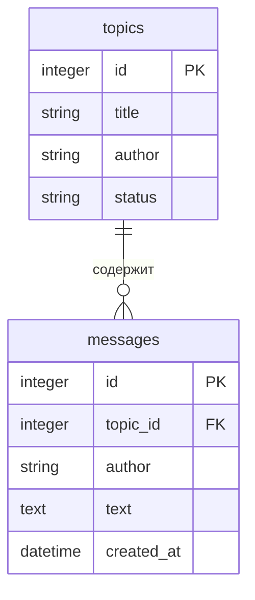

# Форум — лабораторная 2

HTTP API для тем форума. Поля темы: `id`, `title`, `author`, `status` (`open` или `closed`). Идентификатор назначает сервер. Темы хранятся в SQLite и сохраняются после перезапуска сервиса.

Стек: Python, FastAPI, Pydantic, Uvicorn, SQLAlchemy, SQLite, Alembic.

Третий этап лабы 2: создание, получение, изменение и удаление тем работают через базу данных. Фильтры и пагинация выполняются в SQL-запросе. Маршруты сообщений будут добавлены на следующем этапе.

## Запуск

Нужны Python 3.10+ и Git. Откройте папку проекта в VS Code и выполните в PowerShell:

```powershell
python -m venv .venv
.\.venv\Scripts\Activate.ps1
python -m pip install -r requirements.txt
```

При первой настройке скопируйте пример настроек в `.env`:

```powershell
Copy-Item .env.example .env
```

Если `.env` уже существует, используйте его и добавьте `DATABASE_URL` из `.env.example`.

Создайте таблицы командой миграции из корня проекта:

```powershell
python -m alembic upgrade head
```

Запустите сервис:

```powershell
python -m uvicorn app.main:app --host 127.0.0.1 --port 8000 --no-access-log
```

Остановка сервера — `Ctrl+C`.

## Подключение к базе данных

В `.env.example` указана строка подключения для локальной SQLite:

```dotenv
DATABASE_URL=sqlite:///./forum.db
```

Настройка читается из переменной окружения `DATABASE_URL` или файла `.env` в корне проекта.
Переменная окружения имеет приоритет над файлом. Если настройка не задана, модуль базы данных
выдаёт понятную ошибку. Путь `./forum.db` считается относительно папки запуска, поэтому
выполняйте команды из корня проекта.

Проверка подключения:

```powershell
python -c "from app.database import SessionLocal; db = SessionLocal(); print(db.connection().exec_driver_sql('SELECT 1').scalar()); db.close()"
```

Ожидаемый результат — `1`. При первом подключении появляется файл `forum.db`.
Таблицы создаются командой `python -m alembic upgrade head`.

Файлы `.env` и `forum.db` уже исключены из Git через `.gitignore`.
В репозиторий добавляется только пример настроек `.env.example`.

## Таблицы и миграции

Модели таблиц описаны в `app/models.py`. Файлы миграций находятся в `migrations/versions`.
Миграция — это сохранённое изменение схемы базы данных. Alembic применяет миграции по порядку
и записывает текущую версию в служебную таблицу `alembic_version`.

Применить все миграции:

```powershell
python -m alembic upgrade head
```

Повторный запуск команды не создаёт таблицы заново и не удаляет записи.

Посмотреть текущую версию:

```powershell
python -m alembic current
```

После первой миграции команда выводит `0001 (head)`.

Проверить список таблиц:

```powershell
python -c "from sqlalchemy import inspect; from app.database import engine; print(inspect(engine).get_table_names())"
```

Ожидаемый результат: `['alembic_version', 'messages', 'topics']`.

### Схема базы данных



У одной темы может быть много сообщений. Поле `messages.topic_id` ссылается на `topics.id`.
Сообщение без существующей темы сохранить нельзя. При удалении темы из базы её сообщения
тоже удаляются.

Статус темы по умолчанию — `open`. База допускает только `open` и `closed`.
Дата создания сообщения задаётся базой автоматически в UTC.

## Эндпоинты

| Метод  | Путь               | Результат                |
| ------ | ------------------ | ------------------------ |
| GET    | `/health`          | 200, `{"status":"ok"}`   |
| POST   | `/api/topics`      | 201, созданная тема с id |
| GET    | `/api/topics`      | 200, массив тем          |
| GET    | `/api/topics/{id}` | 200 или 404              |
| PATCH  | `/api/topics/{id}` | 200 или 404              |
| DELETE | `/api/topics/{id}` | 204 без тела или 404     |
| GET    | `/docs`            | Swagger UI               |
| GET    | `/openapi.json`    | Спецификация OpenAPI     |

Заголовок обязателен: 1–200 символов, автор: 1–100. Статус по умолчанию — `open`. Неверные данные и сломанный JSON возвращают 400 в формате `{"error":"текст","field":"поле"}`.

Фильтры и пагинация: `/api/topics?author=Иван&status=open&limit=10&offset=0`. `limit`: 1–100, `offset`: от 0. Каждый запрос записывается в лог: метод, путь, статус, время в миллисекундах.

## Проверка

Откройте http://localhost:8000/docs и выполняйте запросы через **Try it out → Execute**. Примеры запросов находятся в `requests.http`.

Для проверки операций с темами через backcheck откройте второй терминал в папке проекта:

```powershell
.\.venv\Scripts\Activate.ps1
$env:NO_PROXY = "localhost,127.0.0.1,::1"
python -m backcheck --lab 1 --stars
```


### Сохранение после перезапуска

1. Запустите сервис и откройте `http://localhost:8000/docs`.
2. Через `POST /api/topics` создайте тему и запомните её `id`.
3. Остановите сервис через `Ctrl+C` и запустите его снова той же командой из той же папки.
4. Выполните `GET /api/topics/{topic_id}` с сохранённым `id`. Должен прийти код 200 и созданная тема.
5. Измените тему через `PATCH`, повторите перезапуск и проверьте новые значения.
6. Удалите тему через `DELETE`. После перезапуска `GET` по этому `id` должен вернуть 404.

Для проверки параметров SQL создайте тему с заголовком `'); DROP TABLE topics;--`.
Он должен сохраниться как обычный текст. Остальные темы и таблицы остаются на месте.

Контракт заполнен в `contract.json`. Знаки `?` у README, Swagger и логов означают ручную проверку на сдаче.

Сдача: PR из ветки `lab-2` в `main`.
