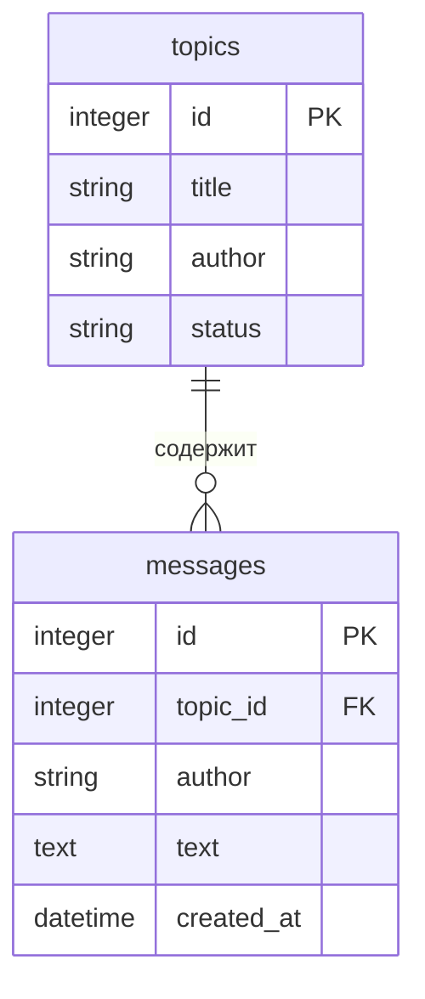

# Форум — лабораторная 2

HTTP API для тем форума и сообщений в них. Поля темы: `id`, `title`, `author`, `status` (`open` или `closed`). Идентификатор назначает сервер. Темы и сообщения хранятся в SQLite и сохраняются после перезапуска сервиса.

Стек: Python, FastAPI, Pydantic, Uvicorn, SQLAlchemy, SQLite, Alembic.

Реализованы базовые требования лабораторной 2 и обе звёздочки. Сохранены валидация, фильтры, пагинация, Swagger и логи запросов из первой лабораторной.

## Чек-лист лабораторной 2

### База

- [x] Темы и сообщения сохраняются после перезапуска сервиса.
- [x] Сообщения связаны с темами внешним ключом; вложенный маршрут поддерживает создание и список.
- [x] Схема создаётся миграциями из репозитория.
- [x] Строка подключения берётся из окружения; есть `.env.example`, паролей в коде нет.
- [x] ER-диаграмма в README показывает обе таблицы, ключи и связь 1:N.
- [x] Строка SQL-инъекции сохраняется как обычный текст, таблицы остаются на месте.

### ★ Миграции, индекс, поиск

- [x] Миграции выполняются через Alembic; сиды заполняют пустую базу одной командой.
- [x] Индекс автора создаётся миграцией; ниже приведены запрос, EXPLAIN и реальный вывод с USING INDEX.
- [x] Поиск `?q=` по заголовку работает без учёта регистра и выполняется в SQL.

### ★★ Правило темы и статистика

- [x] Новое сообщение в закрытую тему даёт 409 с причиной; проверка и запись идут одной транзакцией.
- [x] Статистика самых активных тем считается базой через COUNT и GROUP BY.

## Запуск

Нужны Python 3.10+ и Git. Откройте папку проекта в VS Code и выполните в PowerShell:

```powershell
python -m venv .venv
.\.venv\Scripts\python.exe -m pip install -r requirements.txt
```

Если файла `.env` ещё нет, скопируйте пример настроек:

```powershell
Copy-Item .env.example .env
```

Если `.env` уже существует, используйте его и добавьте `DATABASE_URL` из `.env.example`.

Создайте таблицы командой миграции из корня проекта:

```powershell
.\.venv\Scripts\python.exe -m alembic upgrade head
```

Запустите сервис:

```powershell
.\.venv\Scripts\python.exe -m uvicorn app.main:app --host 127.0.0.1 --port 8000 --no-access-log
```

Остановка сервера — `Ctrl+C`.

## Подключение к базе данных

В `.env.example` указана строка подключения для локальной SQLite:

```dotenv
DATABASE_URL=sqlite:///./forum.db
```

Настройка читается из переменной окружения `DATABASE_URL` или файла `.env` в корне проекта.
Переменная окружения имеет приоритет над файлом. Если настройка не задана, модуль базы данных
выдаёт понятную ошибку. Путь `./forum.db` считается относительно папки запуска, поэтому
выполняйте команды из корня проекта.

Проверка подключения:

```powershell
.\.venv\Scripts\python.exe -c "from app.database import SessionLocal; db = SessionLocal(); print(db.connection().exec_driver_sql('SELECT 1').scalar()); db.close()"
```

Ожидаемый результат — `1`. При первом подключении появляется файл `forum.db`.
Таблицы создаются командой `python -m alembic upgrade head`.

Файлы `.env` и `forum.db` уже исключены из Git через `.gitignore`.
В репозиторий добавляется только пример настроек `.env.example`.

## Таблицы и миграции

Модели таблиц описаны в `app/models.py`. Файлы миграций находятся в `migrations/versions`.
Миграция — это сохранённое изменение схемы базы данных. Alembic применяет миграции по порядку
и записывает текущую версию в служебную таблицу `alembic_version`.

Применить все миграции:

```powershell
.\.venv\Scripts\python.exe -m alembic upgrade head
```

Повторный запуск команды не создаёт таблицы заново и не удаляет записи.

Посмотреть текущую версию:

```powershell
.\.venv\Scripts\python.exe -m alembic current
```

После применения всех миграций команда выводит `0002 (head)`.

Проверить список таблиц:

```powershell
.\.venv\Scripts\python.exe -c "from sqlalchemy import inspect; from app.database import engine; print(inspect(engine).get_table_names())"
```

Ожидаемый результат: `['alembic_version', 'messages', 'topics']`.

### Схема базы данных



У одной темы может быть много сообщений. Поле `messages.topic_id` ссылается на `topics.id`.
Сообщение без существующей темы сохранить нельзя. При удалении темы из базы её сообщения
тоже удаляются.

Статус темы по умолчанию — `open`. База допускает только `open` и `closed`.
Дата создания сообщения задаётся базой автоматически в UTC.

## Тестовые данные

Сиды — это готовые записи для проверки и демонстрации проекта.
Набор находится в `data/seed.json`, команда заполнения — в `app/seed.py`.

Из корня проекта примените миграции и запустите заполнение:

```powershell
.\.venv\Scripts\python.exe -m alembic upgrade head
.\.venv\Scripts\python.exe -m app.seed
```

В пустой базе появятся 4 темы и 6 сообщений:

| Тема | Автор | Статус | Сообщений |
| --- | --- | --- | --- |
| Обсуждение Python | Иван | open | 3 |
| Вопросы по FastAPI | Анна | open | 2 |
| Правила форума | Максим | closed | 1 |
| Работа с SQLite | Иван | open | 0 |

Сообщение в закрытой теме — пример ранее опубликованного сообщения.
Идентификаторы назначает база, даты создания сообщений тоже заполняются автоматически.

Ожидаемый вывод команды: `Добавлено тем: 4, сообщений: 6.`
Все записи добавляются одной транзакцией. При ошибке изменения не сохраняются.

Если в базе уже есть хотя бы одна тема, команда выводит
`В базе уже есть темы. Заполнение пропущено.` и завершает работу.
Существующие записи не изменяются и не удаляются. Дубликаты при повторном запуске не появляются.

Результат можно посмотреть в Swagger через `GET /api/topics` и
`GET /api/topics/{topic_id}/messages`.

## Эндпоинты

| Метод  | Путь               | Результат                |
| ------ | ------------------ | ------------------------ |
| GET    | `/health`          | 200, `{"status":"ok"}`   |
| POST   | `/api/topics`      | 201, созданная тема с id |
| GET    | `/api/topics`      | 200, массив тем          |
| GET    | `/api/topics/stats` | 200, темы по количеству сообщений |
| GET    | `/api/topics/{id}` | 200 или 404              |
| PATCH  | `/api/topics/{id}` | 200 или 404              |
| DELETE | `/api/topics/{id}` | 204 без тела или 404     |
| POST   | `/api/topics/{id}/messages` | 201, созданное сообщение; 404 или 409 |
| GET    | `/api/topics/{id}/messages` | 200, массив сообщений или 404 |
| GET    | `/docs`            | Swagger UI               |
| GET    | `/openapi.json`    | Спецификация OpenAPI     |

Заголовок обязателен: 1–200 символов, автор: 1–100. Статус по умолчанию — `open`. Неверные данные и сломанный JSON возвращают 400 в формате `{"error":"текст","field":"поле"}`.

Фильтры и пагинация: `/api/topics?author=Иван&status=open&limit=10&offset=0`. `limit`: 1–100, `offset`: от 0. Каждый запрос записывается в лог: метод, путь, статус, время в миллисекундах.

## Поиск тем

Параметр `q` ищет часть заголовка без учёта регистра:

```http
GET /api/topics?q=python
GET /api/topics?q=ОБСУЖДЕНИЕ
GET /api/topics?q=python&author=Иван&status=open&limit=10&offset=0
```

Поиск работает с русскими и английскими буквами. Условия поиска, фильтров и пагинации
выполняются в одном SQL-запросе. Для сравнения русских букв при подключении к SQLite
регистрируется функция `casefold`.

Пробелы по краям `q` убираются. Допустимая длина — 1–200 символов.
Пустой запрос или строка из пробелов дают 400 с `field=q`.
Если `q` не передан, возвращается обычный список тем.
Символы `%` и `_` ищутся как обычный текст.

## Индекс и EXPLAIN

Миграция `0002` создаёт индекс `ix_topics_author` на поле `topics.author`.
Он используется для фильтра по автору, например `GET /api/topics?author=Иван`.
Подстрочный поиск по заголовку выполняется отдельным условием SQL.

Запрос, для которого создан индекс:

```sql
SELECT id, title, author, status
FROM topics
WHERE author = 'Иван'
ORDER BY id
LIMIT 10 OFFSET 0;
```

План запроса:

```sql
EXPLAIN QUERY PLAN
SELECT id, title, author, status
FROM topics
WHERE author = 'Иван'
ORDER BY id
LIMIT 10 OFFSET 0;
```

Чтобы получить план из своей базы, примените миграции и выполните:

```powershell
.\.venv\Scripts\python.exe -m alembic upgrade head
.\.venv\Scripts\python.exe -m app.explain
```

Вывод проверки на тестовой базе:

```text
SEARCH topics USING INDEX ix_topics_author (author=?)
```

`USING INDEX ix_topics_author` показывает использование индекса.
Команда `app.explain` берёт значение автора через параметр SQL.

## Сообщения

Сначала создайте открытую тему через `POST /api/topics` и возьмите её `id` из ответа.
Чтобы добавить сообщение, отправьте `POST /api/topics/{topic_id}/messages`:

```json
{
  "author": "Иван",
  "text": "Первое сообщение"
}
```

Автор обязателен: 1–100 символов. Текст обязателен: 1–5000 символов.
Пробелы по краям убираются, пустые строки и неверные типы дают 400.
Передать свои `id`, `topic_id` или `created_at` в теле запроса нельзя.

В ответе с кодом 201 приходят `id`, `topic_id`, `author`, `text` и `created_at`.
Дата создаётся автоматически в UTC и возвращается в формате ISO 8601.

`GET /api/topics/{topic_id}/messages` возвращает сообщения только этой темы
в порядке возрастания `id`. Если сообщений ещё нет, возвращается пустой массив.
Для несуществующей темы оба запроса возвращают 404.

Чтобы проверить сохранение, создайте сообщение, перезапустите сервис и запросите список снова.
После удаления темы её сообщения удаляются из базы.

## Правило закрытой темы

В закрытую тему нельзя добавлять новые сообщения.
Для закрытия темы выполните `PATCH /api/topics/{topic_id}`:

```json
{"status": "closed"}
```

После этого `POST /api/topics/{topic_id}/messages` отвечает 409:

```json
{
  "error": "В закрытую тему нельзя добавлять сообщения",
  "field": "status"
}
```

Отклонённое сообщение не сохраняется. Читать прежние сообщения закрытой темы можно.
После изменения статуса обратно на `open` новые сообщения снова принимаются.

Перед проверкой темы сервер выполняет `BEGIN IMMEDIATE`.
Проверка статуса и добавление сообщения идут в одной транзакции.
Пока она не завершена, другая запись в SQLite ожидает её окончания.
При 404 или 409 выполняется откат, при успешном сохранении — `commit`.

## Статистика активности тем

`GET /api/topics/stats` возвращает список тем с количеством сообщений.
Самые активные темы идут первыми. При равном количестве сортировка идёт по `topic_id`
по возрастанию. Темы без сообщений тоже включены с количеством 0.
В пустой базе возвращается `[]`.

Пример элемента ответа:

```json
{
  "topic_id": 1,
  "title": "Обсуждение Python",
  "message_count": 3
}
```

Количество считает база данных через `COUNT` и `GROUP BY`:

```sql
SELECT topics.id AS topic_id, topics.title, COUNT(messages.id) AS message_count
FROM topics
LEFT JOIN messages ON messages.topic_id = topics.id
GROUP BY topics.id, topics.title
ORDER BY message_count DESC, topics.id;
```

Для набора сидов количество сообщений по темам: 3, 2, 1, 0.
После создания сообщения статистика обновляется при следующем запросе.
Удалённые темы в результат не попадают.

## Проверка

Запустите сервис по инструкции выше. Откройте `http://localhost:8000/docs` и выполняйте
запросы через **Try it out → Execute**. В `requests.http` находятся 50 примеров:
темы, сообщения, ошибки, поиск, правило закрытой темы и статистика.

Официальный чекер backcheck включён в `requirements.txt` и устанавливается вместе
с остальными зависимостями проекта. Закреплена проверенная версия из репозитория преподавателя.

Во втором терминале из корня проекта выполните:

```powershell
.\.venv\Scripts\python.exe -m pip install -r requirements.txt
$env:NO_PROXY = "localhost,127.0.0.1,::1"
.\.venv\Scripts\python.exe -m backcheck --lab 2 --stars
```

Для проверки сохранённых возможностей первой лабораторной:

```powershell
.\.venv\Scripts\python.exe -m backcheck --lab 1 --stars
```

Знак `?` означает, что пункт нужно показать преподавателю: перезапуск, применение миграций,
заполнение базы, ER-диаграмму и место в коде с транзакцией или агрегатным SQL.
Это не ошибка и не признак отсутствующей функции.

[Отчёт итоговой проверки](docs/lab-2-check.md) содержит результаты официального backcheck
и дополнительных проверок. Проверено в отдельной копии проекта с новым окружением и пустой SQLite.
Все 50 примеров запросов дали ожидаемые коды. Проваленных проверок backcheck нет.
Отдельно проверены пункты для ручного показа: перезапуск, миграции, сиды, индекс и транзакция.

### Сохранение после перезапуска

1. Запустите сервис и откройте `http://localhost:8000/docs`.
2. Через `POST /api/topics` создайте тему и запомните её `id`.
3. Остановите сервис через `Ctrl+C` и запустите его снова той же командой из той же папки.
4. Выполните `GET /api/topics/{topic_id}` с сохранённым `id`. Должен прийти код 200 и созданная тема.
5. Измените тему через `PATCH`, повторите перезапуск и проверьте новые значения.
6. Удалите тему через `DELETE`. После перезапуска `GET` по этому `id` должен вернуть 404.

Для проверки параметров SQL создайте тему с заголовком `'); DROP TABLE topics;--`.
Он должен сохраниться как обычный текст. Остальные темы и таблицы остаются на месте.

Контракт для базы и обеих звёздочек заполнен в `contract.json`.

## Сдача

1. Проверьте проект командами из раздела выше.
2. Сохраните итоговые изменения коммитом и отправьте ветку `lab-2` на GitHub.
3. Откройте PR в своём репозитории: `lab-2` → `main`. Шаблон PR содержит чек-лист второй лабораторной.
4. На сдаче покажите API, миграции, сиды, EXPLAIN, перезапуск и код транзакции.
5. После приёма лабораторной PR вливается в `main`.

Техническая часть даёт до 10 баллов: база 6, ★ 2, ★★ 2.
Ещё до 2 баллов ставятся за ответ на вопрос и объяснение кода.
[Вопросы к лабораторной](docs/lab-2.md#вопросы-к-лабе) и
[правила сдачи и сроки](docs/README.md#как-сдавать).
